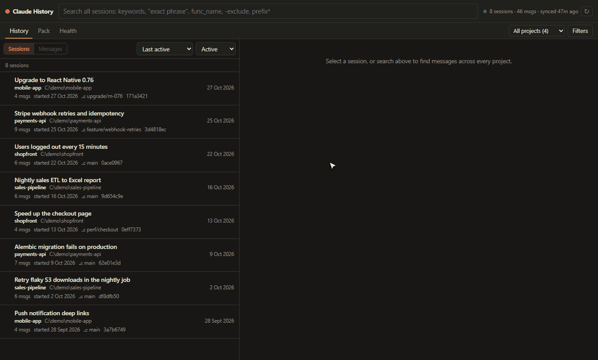

# Claude History: global memory for Claude Code

Search, browse and reuse **every** Claude Code conversation on your machine, whichever repository you have open.



Claude Code stores each session under a directory named after the folder it ran in, and its resume pickers only show the current folder's history. This app indexes all of them into one local SQLite full-text index. You can reach that index three ways:

| Entry point | What it's for |
|---|---|
| **Claude Code itself** (MCP server, registered for all projects) | Ask Claude "how did we fix the pyodbc driver error last month?" in *any* repo. It calls `search_history` → `get_message_context`. |
| **VS Code extension** (`Ctrl+Alt+H`) | The same search UI in a VS Code tab, *Search history for selection*, and one-click **resume** of any past session in the integrated terminal. |
| **Web app** `http://127.0.0.1:8765` | Browse and search with filters, read sessions, build context packs, check index health. |
| **CLI** `cch` | Search and pull context from the terminal, or pipe a context pack to the clipboard. |

The app is local-first, uses only the Python standard library (3.11+), and never writes to `~/.claude/projects`.

## Quick start (Windows)

```bash
cch sync
```
```bash
cch serve --open
```

Or double-click `claude-history.cmd`. On Windows, put `cch.cmd` somewhere on your PATH (for example `%USERPROFILE%\bin`) to run `cch` from any folder. Elsewhere, use `python path/to/cch.py <command>`.

**In Claude Code:** the `claude-history` MCP server is registered at user scope in `~/.claude.json`. Start a new session in any folder and run `/mcp` to see it connected. To re-register it (for example after moving this folder or changing Python):

```bash
cch install-mcp
```

## VS Code extension
It's published as **History for Claude Code** (`jamesmithiga.history-for-claude-code`); see [docs/publishing.md](docs/publishing.md). Reload open windows once (*Developer: Reload Window*) after installing or updating it.

| Do this | How |
|---|---|
| Search everything | `Ctrl+Alt+H`, or click **History** in the status bar |
| Look up an error or symbol | Select it → `Ctrl+Alt+Shift+H`, or right-click → *Search History for Selection* |
| Continue a past session | Command palette → *Claude History: Continue a Past Session…*, or the buttons in a session's header |
| Reuse context | Build a pack, then **Send to chat**, **Insert in editor**, **Copy** or **Save as…** |

**Continuing a session from VS Code:**
- **Continue in chat** reopens the conversation in Claude Code's chat panel with its full history. The chat panel can only open sessions that belong to the folder of the current window. If the session is from another folder, that folder opens in a new window and the conversation opens in its chat panel automatically.
- **Bring into this chat** starts a new Claude chat in the current workspace, pre-filled with a request to load that session through the `claude-history` tools, summarise it and carry on. You review and send it. This works for any session, including ones whose transcript Claude Code has deleted.
- **Terminal** runs `claude --resume` in an integrated terminal in the session's original folder. It's also the automatic fallback if the chat panel can't be reached.

Continue in chat and Send to chat use `claude-vscode.editor.open(sessionId, prompt)`, the command behind Claude Code's `vscode://anthropic.claude-code/open?session=…&prompt=…` link handler. That command isn't in Anthropic's README, so a future Claude Code update could change it; if it does, the buttons fall back to the terminal.

The extension bundles a copy of this Python app and shares the backend (port 8765) and the index with the CLI, the browser UI and the MCP server. After changing the Python code, rebuild and reinstall:
```bash
cd vscode-extension && npm run package && code --install-extension dist/history-for-claude-code.vsix --force
```
The same `.vsix` installs in VS Code forks such as Cursor or Antigravity (*Extensions → … → Install from VSIX*). Publishing to the Marketplace or Open VSX needs your own publisher id: set `publisher` in `vscode-extension/package.json`, then run `vsce publish` / `ovsx publish`.

Tests: `npm test` runs the helper and backend tests. `npm run test:integration -- <sessionId> <sessionCwd>` launches an isolated VS Code and checks activation, commands, the webview and both resume paths.

## Using it

### Search syntax (web, CLI and MCP)
| You type | Meaning |
|---|---|
| `jwt refresh` | both words, any order |
| `"duplicate column name"` | exact phrase |
| `load_workbook`, `foo.bar()`, `C:\path\x.py` | identifiers and paths match as phrases |
| `migrat*` | prefix |
| `error -openpyxl` | exclude |
| `pyodbc OR pymssql`, `(a OR b) c` | boolean |
| **Literal text** mode / `--literal` | raw substring, for odd fragments |

Filters: project, message type (user / Claude / tool calls / tool output / thinking / memory), date range, referenced file path, subagents on/off. Sort by relevance, newest or oldest.

### Web app keys
`/` search · `j`/`k` move through matching messages · `Enter` open full session · `a` add the current hit to the context pack · `c` copy the hit with attribution · `1`–`3` switch between History, Pack and Health · `Esc` back to the list on narrow screens.

**History** is one list. With the search box empty it shows your sessions, newest first. Type to see matching messages, or switch to **Sessions** to see the sessions that contain matches, with a count on each.

### CLI
```text
cch search "No module named" -p my-api --since 2026-10-01
cch context 8485 -B 6 -A 6          # message + surrounding conversation
cch show 3f2a9c1e                    # whole session (id prefix ok); --tools to include tool I/O
cch sessions migration               # sessions by title/prompt
cch projects
cch pack 8485 7561 --task "set up SQL Server access" --copy   # → clipboard
cch resume 3f2a9c1e [--vscode]       # continue a past session (see below)
cch archive 3f2a9c1e [--undo]        # hide sessions from search and lists (reversible)
cch delete 3f2a9c1e                  # remove from the index; `cch deleted` lists, `cch restore` undoes
cch sync [--full]                    # incremental / full rescan
cch status                           # inventory, errors, last sync
```
Add `--json` to `search`, `context`, `show`, `sessions`, `status` and `sync` for scripting.

### Continue a past conversation in VS Code
Claude Code resumes a session only from the **folder it ran in**, and its history list only shows that folder's sessions. `cch resume` handles both: it switches to the original folder and runs the `claude` binary that ships with the VS Code extension (always the newest installed version), so `claude` doesn't need to be on PATH.

| Where | How |
|---|---|
| Web app, session header | **Continue in VS Code** opens the session's folder in VS Code and copies `cch resume <id>`. Paste it into VS Code's terminal (`` Ctrl+` ``), or pick the session from the Claude Code panel's history list. **Resume in terminal** resumes it in a new console window. |
| Any terminal, including VS Code's | `cch resume 3f2a9c1e` (id or unique prefix) resumes right there |
| | `cch resume 3f2a9c1e --vscode` opens the folder in VS Code; add `--here` to also resume in this terminal |
| | `cch resume 3f2a9c1e --new-window` resumes in a separate console; `--print` only shows the command |

A session **can't** be resumed if Claude Code has already deleted its transcript, or if its folder no longer exists. The web app then shows *Can't resume: …*. You can still continue that work from any repo: ask Claude to "use claude-history to load session `<id>` and continue", or paste a context pack. That starts a new conversation seeded with the retrieved history.

### Archive and delete
Neither one touches Claude Code's own transcript files.
- **Archive** hides a session from search, the Sessions list, project counts and Claude's MCP searches. It's reversible:
  - In History, switch **Active** to **Archived** to list what's hidden, with an **Unarchive** button on each session.
  - **Filters → Include archived** searches archived sessions too.
- **Delete from index** removes the session's messages and keeps it out of future syncs.
  - **Health → Deleted from the index** lists deletions with **Restore**, which re-reads the original transcript.
  - Restore only works while Claude Code still has that file.
- Both work on one session (buttons in its header) or many (hover a session in the list and tick it, then use the bar at the top).

### Context packs
Collect excerpts from any project (`+ Pack` in the web app, or `cch pack <ids>`), then copy one Markdown document into a new conversation. Each pack:

- opens with a notice that its content is **historical and from other directories**
- lists project, original directory (flagged if it no longer exists), session id and dates for each session
- has a token budget (whole session blocks are dropped first, then trimmed)
- redacts likely secrets (API keys, tokens, JWTs, private keys, URL and connection-string passwords). This happens only in the export; the index keeps the original text.

Saved packs go to `~/.claude-history/packs/`.

## Keeping it current
- The **MCP server syncs in the background every time a Claude Code session starts**, in any repo, and again before answering if its last sync is more than 30 s old.
- The **web app** syncs every 20 s while it runs. The status pill shows the last sync time, and **Index health** lists files that failed or were skipped.
- `cch sync --full` (or *Full rescan* in Index health) re-reads everything. It is idempotent.

> **Important — retention.** Claude Code deletes transcripts older than `cleanupPeriodDays` (default about 30 days). The index keeps everything it has already seen, but it can't recover what was deleted before it ran.
> ```json
> { "cleanupPeriodDays": 3650 }
> ```

## Where things live
| What | Where |
|---|---|
| Code | wherever you cloned this repository |
| Index, log, packs | `~/.claude-history/` (`index.db`, `claude-history.log`, `packs/`) |
| Config (optional) | `~/.claude-history/config.toml`; see `config.example.toml` |
| Source history (read-only) | `~/.claude/projects/` (or `$CLAUDE_CONFIG_DIR/projects/`) |

Environment overrides: `CLAUDE_HISTORY_DATA`, `CLAUDE_HISTORY_CONFIG`, `CLAUDE_HISTORY_PORT`, `CLAUDE_CONFIG_DIR`.

## Privacy and security
- The web server binds to `127.0.0.1` only. It rejects foreign `Host` headers (DNS rebinding) and cross-origin POSTs, sends no CORS headers, and serves a strict CSP.
- Nothing is sent over the network. No AI API is used or required.
- Logs record request paths and sync counts, never query strings or message text.
- **Deleting the index never touches your history.** `index.db` is a derived copy: delete `~/.claude-history` to remove it, then run `cch sync` to rebuild. Deleting files under `~/.claude/projects` is a separate action, and the app never does it.
- The index contains everything your sessions contained, including any secrets pasted into them. Protect `~/.claude-history` the same way you protect `~/.claude`.

## Backup
`index.db` is a single SQLite file in WAL mode. To back it up while the app runs:
```bash
python -c "import sqlite3,os;s=sqlite3.connect(os.path.expanduser('~/.claude-history/index.db'));d=sqlite3.connect('index-backup.db');s.backup(d)"
```
Because the index keeps transcripts that Claude Code has since deleted, it is worth backing up.

## Troubleshooting
| Symptom | Fix |
|---|---|
| `/mcp` doesn't list `claude-history` | Start a *new* session; run `cch install-mcp`; check `~/.claude-history/claude-history.log` |
| Web app says "server unreachable" | Run `cch serve`. If port 8765 is taken, set `CLAUDE_HISTORY_PORT` or `port` in the config |
| A query with symbols returns nothing | Use Literal text mode / `--literal` |
| Sessions from a deleted repo show "directory no longer exists" | Expected. History stays readable. |
| "Index schema vN is newer than this app" | You ran a newer version on this index; update the code |
| Errors in Index health | The listed file couldn't be read; it is retried on every sync |

## Tests
```bash
python -m unittest discover -s tests -v
```
```bash
python tests/acceptance_real.py --out docs/acceptance-results.md
```
The first runs 30 unit and integration tests on fixture transcripts that mirror the real format: malformed lines, partial writes, duplicates, interrupted sync, rewritten and deleted sources, redaction, MCP protocol and HTTP security. The second runs the 12 acceptance scenarios and benchmarks against your real `~/.claude`, using a throwaway index. Latest results: [docs/acceptance-results.md](docs/acceptance-results.md).

## Project layout
```text
cch.py / cch.cmd / claude-history.cmd   entry points (work from any directory)
claude_history/
  config.py        defaults → config.toml → env
  db.py            schema, versioned migrations, connections
  parser.py        JSONL record → message rows (format knowledge lives here)
  ingest.py        discovery, incremental crash-safe sync, inventory
  search.py        FTS query builder, retrievers (pluggable), context, sessions
  contextpack.py   pack assembly, token budget, redaction
  server.py        local HTTP API + static UI, background sync
  mcp_server.py    MCP stdio server for Claude Code
  resume.py        locate bundled claude/VS Code, validate & launch `--resume`
  cli.py           cch command
  web/             index.html, app.js, app.css (no build step)
tests/             unit/integration tests + real-data acceptance script
tools/             demo history generator, screenshot capture (headless Edge/Chrome), GIF builder
vscode-extension/  VS Code extension (extension.js, lib/core.js, tests; bundles the Python app into python/)
docs/              history format & limits, roadmap, acceptance results
```

**Why stdlib instead of FastAPI/React:** the app has to start the same way from any workspace, from Claude Code's MCP launcher, with no venv or build step to break. SQLite FTS5 gives sub-20 ms median searches on this history, so extra infrastructure wouldn't speed anything up. Ranking already goes through a `Retriever` protocol, so semantic search can be added without a rewrite ([docs/roadmap.md](docs/roadmap.md)).
